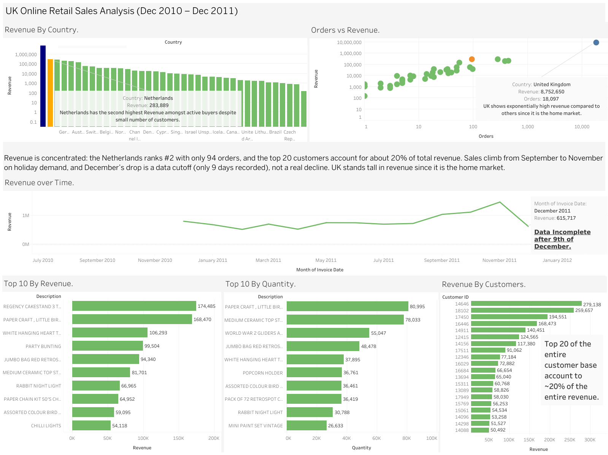

# UK Online Retail Sales Analysis

**Live dashboard:** [Tableau Public](https://public.tableau.com/app/profile/lokesh.sundar5144/viz/uk_sales_analysis/UKOnlineRetailSalesAnalysis_)

I analyzed about 530,000 transactions from a UK online gift retailer (Dec 2010 – Dec 2011) to see where its revenue really comes from. I used MySQL for the analysis and Tableau for the dashboard.

## Key Findings
- **Revenue is concentrated.** The Netherlands ranks 2nd in revenue with only 94 orders, and 98.3% of it comes from a single customer. Across the whole business, the top 20 customers account for 20.4% of total revenue.
- **Sales rise toward the holidays.** Revenue climbs from September to November. December looks like a drop, but the data stops on 9 December, so it's a data cutoff, not a real decline.
- **Best sellers depend on how you measure.** Top products by quantity (cheap, high-volume items) differ from top products by revenue (e.g. the Regency Cakestand).
- **Cleaning mattered.** POSTAGE, DOTCOM POSTAGE and Manual entries (StockCodes POST, DOT, M) are shipping/admin lines, not products, so I excluded them. Returns (negative quantities) were excluded from revenue.

## Tools
MySQL (analysis), Tableau Public (dashboard)

## Files
- `sql/uk_sales_analysis.sql` – all queries, in the order I ran them
- `dashboard/dashboard.png` – dashboard screenshot

## Data
Online Retail dataset (UK-based online gift retailer, 01/12/2010 – 09/12/2011), by Daqing Chen, Sai Laing Sain and Kun Guo (2012), from the [UCI Machine Learning Repository](https://archive.ics.uci.edu/dataset/352/online+retail). Licensed under CC BY 4.0. Revenue figures are in GBP (£).

## License
The code in this repository (SQL queries) is released under the MIT License. The dataset remains under its original CC BY 4.0 license.
